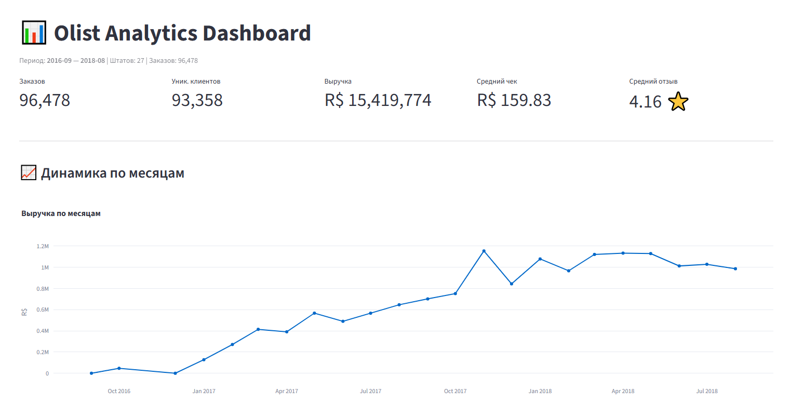
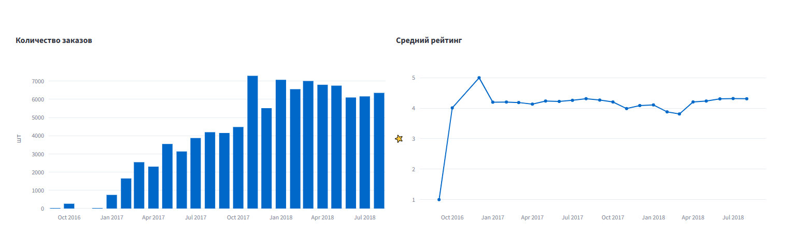
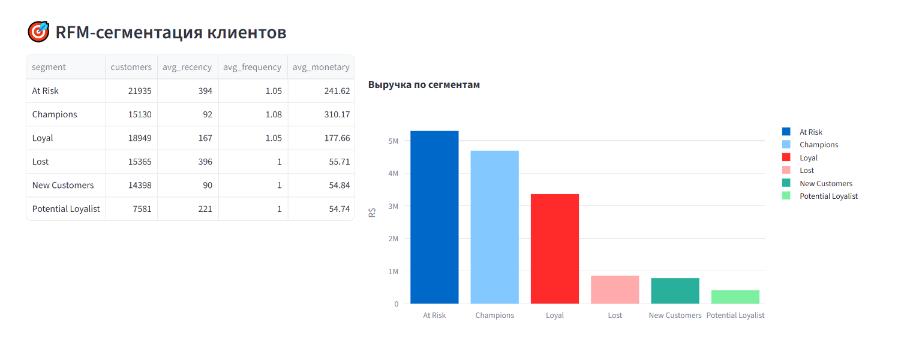
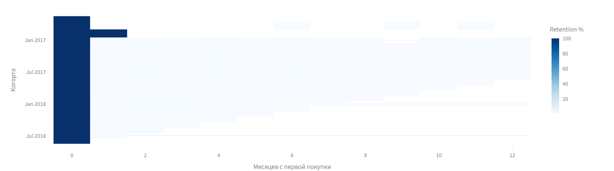
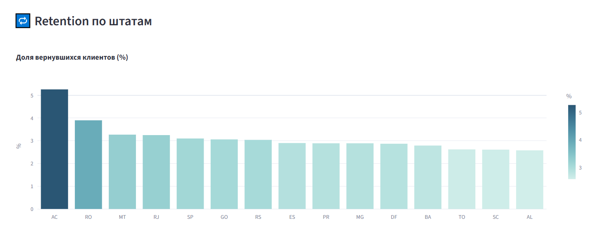

# Olist Analytics Dashboard

Аналитический дашборд для e-commerce датасета **Olist Brazilian E-Commerce**:
полный цикл **ETL → SQLite → SQL-аналитика → интерактивный BI-дашборд**.

Демонстрирует навыки, которые спрашивают на собеседованиях дата-аналитика:
SQL (CTE, window functions, JOIN), ETL на Python, построение дашбордов.

---

## 🎯 Что внутри

| Блок | Что показывает |
|---|---|
| **ETL** | Загрузка CSV → очистка → запись в SQLite |
| **SQL** | CTE, `NTILE`, `LAG`, `ROW_NUMBER`, агрегации, JOIN |
| **BI** | Streamlit + Plotly: интерактивные фильтры, KPI, графики |
| **Метрики** | RFM-сегментация, Cohort analysis, Retention |

---

## Стек

- **Python 3.13.3** — pandas, numpy, SQLAlchemy
- **SQLite** — хранилище (легко заменить на PostgreSQL)
- **Streamlit** + **Plotly** — дашборд
- **SQL** — вся аналитика

---

## Структура проекта

```
olist_analytics/
├── data/
│   ├── raw/                    # Исходные CSV (не в git)
│   │   ├── sellers_clean.csv
│   │   └── master_orders.csv
│   └── olist.db                # SQLite (генерируется ETL)
├── etl/
│   ├── __init__.py
│   ├── loader.py               # загрузка CSV
│   ├── cleaner.py              # очистка и нормализация
│   └── db_writer.py            # запись в SQLite
├── sql/
│   ├── schema.sql              # DDL + индексы
│   ├── aggregates.sql          # KPI по месяцам + LAG
│   ├── rfm.sql                 # RFM через NTILE
│   ├── cohort.sql              # Cohort analysis
│   └── retention.sql           # Retention по штатам
├── dashboard/
│   └── app.py                  # Streamlit-приложение
├── docs/                       # скриншоты для README
├── run_etl.py                  # точка входа ETL
├── requirements.txt
├── .gitignore
└── README.md
```

---

## Данные

Используется публичный датасет **Brazilian E-Commerce Public Dataset by Olist**
(≈ 100 000 заказов, 2016–2018).

**Скачать:**
- Kaggle: https://www.kaggle.com/datasets/olistbr/brazilian-ecommerce

**Что положить в `data/raw/`:**
- `master_orders.csv` — заказы + клиенты + отзывы
- `sellers_clean.csv` — справочник продавцов

> ⚠️ CSV-файлы **не коммитятся** в репозиторий (см. `.gitignore`) — из-за размера.
> Перед запуском положи их в `data/raw/` вручную.

---

## Как запустить проект.

### 1. Клонировать репозиторий

```bash
git clone https://github.com/<your-username>/project-retail-dashboard.git
cd project-retail-dashboard
```

### 2. Виртуальное окружение

```bash
# Windows
python -m venv venv
venv\Scripts\activate

# macOS / Linux
python3 -m venv venv
source venv/bin/activate
```

### 3. Установить зависимости

```bash
pip install -r requirements.txt
```

### 4. Положить CSV в `data/raw/`

См. раздел **«Данные»** выше.

### 5. Запустить ETL

```bash
python run_etl.py
```

Ожидаемый вывод:

```
Схема инициализирована
Загружаем sellers...
Загружаем orders (может занять ~10 сек)...
sellers: 3,095 строк записано
customers: 99,441 строк записано
orders: 99,441 строк записано
ETL завершён
```

После этого появится база **`data/olist.db`**.

### 6. Запустить дашборд

```bash
streamlit run dashboard/app.py
```

Открой **http://localhost:8501** в браузере.

---

## 📈 Что показывает дашборд

### KPI-карточки (верх страницы)
- Количество заказов
- Уникальные клиенты
- Выручка (R$)
- Средний чек
- Средний рейтинг отзыва




### Динамика по месяцам
- Выручка (line chart)
- Количество заказов (bar chart)
- Средний рейтинг (line chart)

### 🎯 RFM-сегментация
Разбивка клиентов на сегменты через `NTILE(5)`:

| Сегмент | Характеристика |
|---|---|
| **Champions** | R≥4, F≥4, M≥4 — покупают часто и недавно |
| **Loyal** | R≥3, F≥3 — постоянные клиенты |
| **New Customers** | R≥4, F≤2 — только что пришли |
| **At Risk** | R≤2, F≥3 — раньше покупали, давно не возвращались |
| **Lost** | R≤2, F≤2, M≤2 — потеряны |
| **Potential Loyalist** | все остальные |



### Cohort Analysis
Heatmap retention: сколько % клиентов из каждой когорты (по месяцу первой покупки)
вернулись в N-й месяц после старта.



### Retention по штатам
Топ-15 штатов по доле клиентов, совершивших повторную покупку.



---

## Ключевые SQL-запросы

### `sql/aggregates.sql` — KPI + LAG для роста выручки

```sql
ROUND(100.0 * (revenue - LAG(revenue) OVER (ORDER BY order_month))
      / NULLIF(LAG(revenue) OVER (ORDER BY order_month), 0), 2) AS revenue_growth_pct
```

### `sql/rfm.sql` — RFM через NTILE

```sql
NTILE(5) OVER (ORDER BY recency_days DESC) AS r_score,
NTILE(5) OVER (ORDER BY frequency ASC)  AS f_score,
NTILE(5) OVER (ORDER BY monetary ASC)   AS m_score
```

### `sql/cohort.sql` — расчёт `month_offset` для когорт

```sql
(
    (CAST(SUBSTR(o.order_month, 1, 4) AS INTEGER) -
     CAST(SUBSTR(f.cohort_month, 1, 4) AS INTEGER)) * 12
    + (CAST(SUBSTR(o.order_month, 6, 2) AS INTEGER) -
       CAST(SUBSTR(f.cohort_month, 6, 2) AS INTEGER))
) AS month_offset
```

---

## Навыки, которые демонстрирует проект

- ✅ **ETL на Python** — загрузка, очистка, запись в БД
- ✅ **SQL: JOIN** — `orders ⨝ first_order` в cohort-запросе
- ✅ **SQL: CTE** — везде, где сложная логика
- ✅ **SQL: window functions** — `NTILE`, `LAG`, `ROW_NUMBER`
- ✅ **SQL: агрегации** — `GROUP BY`, `HAVING`, `SUM`, `AVG`, `COUNT(DISTINCT)`
- ✅ **BI / дашборды** — Streamlit + Plotly, интерактивные фильтры
- ✅ **Бизнес-метрики** — RFM, Cohort, Retention — то, что спрашивают на собесах

---


## Автор

- GitHub: [@SoYaMin1](https://github.com/SoYaMin1)


## Благодарности

- Датасет: Kaggle - https://www.kaggle.com/datasets/olistbr/brazilian-ecommerce
